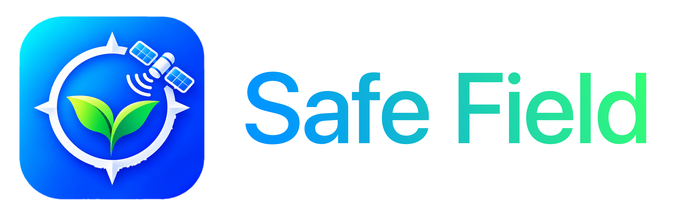

  

  Making agricultural data easier to understand, one field at a time.

  A Nepal-focused agricultural research prototype built for the
  <a href="https://www.spaceappschallenge.org/2026/challenges/field-shift-adapting-farms-with-nasa-data/">NASA Space Apps Challenge 2026</a>.

  
  
  

---

## Why We Built Safe Field Nepal

Farmers make important decisions based on rainfall, soil conditions, weather and the changing environment. However, useful environmental information is often spread across different sources and can be difficult to interpret at an individual farm level.

We chose this project because we wanted to explore how satellite observations and open environmental data could become easier for Nepalese farmers to access and understand. Safe Field Nepal brings available rainfall information, weather forecasts, soil-texture estimates and terrain context together in one location-aware platform.

Our goal is simple: farmers should not need to understand complex satellite datasets to explore information about their land. The application presents available evidence in a more approachable way, while showing its source, date, freshness and limitations.

- **Live prototype:** https://safefieldnp.netlify.app
- **Project presentation:** https://canva.link/oef8hx002ollo33

The interface supports **English and Nepali**.

## What It Can Do

A farmer can start by searching for a place, selecting a district, using GPS or choosing a point directly on the map. Drawing a field boundary is optional, so users can begin with a simple location selection.

After selecting a location, the prototype can help users explore:

- **Field mapping:** Find a location, mark a point and optionally draw a field boundary.
- **Rainfall information:** Explore recent rainfall estimates using NASA GPM IMERG data when a fresh local cache is available, with a fallback to Open-Meteo past-days reanalysis where supported.
- **Weather forecasts:** View short-term forecasts from Open-Meteo, identified separately from NASA data.
- **Soil information:** Explore estimated sand, silt and clay fractions from ISRIC SoilGrids.
- **Terrain context:** View elevation and estimated slope information.
- **Climate trends:** Explore historical heavy-rain-day frequency using NASA POWER records.
- **Environmental screening:** Review a preliminary screening result based on available rainfall, forecast, soil-texture, wetness and slope inputs.
- **Farm records:** Record crop setup, field activities, irrigation and farmer-entered observations.
- **Offline awareness:** Use a recent browser-cached assessment when offline, while retaining its original timestamps and identifying it as cached information.

The screening result uses labels such as `CONDITIONS LOOK SUITABLE`, `WAIT AND RECHECK` and `LOCAL REVIEW NEEDED`. These are preliminary screening labels, not fertilizer instructions or guarantees about field conditions.

## Is It Designed for Farmers?

Yes. Farmer accessibility is one of the main reasons for building the project. The workflow starts with familiar actions: find a place, select a district, use the phone's location or mark land on a map. Users do not need to configure scientific datasets themselves.

The interface is designed to keep information understandable through clear labels, visible measurements and explanations of where the data comes from. English and Nepali language support is included to make the experience more accessible in Nepal.

We want Safe Field Nepal to become a practical tool that farmers can use to explore their land and make more informed decisions—not a complicated scientific dashboard.

However, being designed for farmers does not yet mean that farmer usability has been proven. This is a research prototype, and its ease of use and practical value still need to be evaluated with local farmers and agricultural experts. Feedback from real users will help us improve the language, location-selection workflow, map experience and way information is presented.

## How It Works

Safe Field Nepal combines several environmental and geospatial sources. Each source has different coverage, resolution and update timing, so the application aims to show data provenance and limitations rather than presenting every value as a direct field measurement.

| Data source | How it is used |
|---|---|
| [NASA GPM IMERG](https://gpm.nasa.gov/data/imerg) | Recent rainfall grid when a fresh local cache is available |
| [NASA POWER](https://power.larc.nasa.gov/) | Historical and regional climate context |
| [Open-Meteo](https://open-meteo.com/) | Short-term weather forecast and past-days rainfall fallback |
| [ISRIC SoilGrids](https://soilgrids.org/) | Predicted soil-texture fractions |
| [Open-Meteo Elevation API](https://open-meteo.com/en/docs/elevation-api) | Elevation context, using Copernicus DEM GLO-90 as its primary dataset |
| [OpenFreeMap](https://openfreemap.org/) and [Esri World Imagery](https://www.esri.com/) | Map display and optional imagery layer |

The current assessment API is geographically bounded to Nepal coordinates between **26.3–30.5° N** and **80.0–88.3° E**. The API identifies Morang, Sunsari, Jhapa and Ilam as pilot districts.

## Built With

| Layer | Technologies |
|---|---|
| Frontend | Next.js, React, TypeScript, Tailwind CSS |
| Maps and visualisation | MapLibre GL JS, Recharts, Lucide React |
| Backend API | Python, FastAPI, Pydantic, Uvicorn |
| Scientific analysis | NumPy, SciPy, pymannkendall, statsmodels |
| Geospatial processing | earthaccess, xarray, netCDF4, Shapely, pyproj |
| Data cache | SQLite |

## Current Scope and Limitations

Safe Field Nepal is an **educational research prototype**, not a validated agronomic advisory service.

The current working prototype focuses on field location, environmental context, rainfall and weather evidence, climate-trend exploration and cautious fertilizer-timing screening. It does **not yet generate, rank or compare crop-rotation plans**. That would require additional crop-calendar and rotation data, farmer-priority inputs, locally reviewed agronomic rules and field validation.

Some important limitations:

- Screening thresholds are preliminary design assumptions and have not yet been validated by Nepalese agronomists.
- Satellite and gridded datasets cover areas much larger than an individual farm. Drawing a field boundary does not increase the resolution of the underlying data.
- SoilGrids provides modelled estimates, not laboratory soil-test results.
- NASA POWER wetness variables are modelled proxies, not direct soil-moisture sensor measurements.
- Forecasts and reanalysis products have uncertainty and must be distinguished from observations.
- Farmer-entered records are user-provided information, not independently verified measurements.
- The project has not yet established completed farmer trials, expert sign-off, real-device acceptance testing or production readiness.
- The prototype does not calculate fertilizer doses or provide validated fertilizer application instructions.

Farmers should verify field conditions locally, use appropriate soil tests and consult local agricultural extension services before making important farming decisions.

For further details, see the [validation plan](docs/VALIDATION_PLAN.md).

## Acknowledgements

Developed for the **NASA Space Apps Challenge 2026**, under the challenge **Field Shift: Adapting Farms with NASA Data**.

We acknowledge NASA and the open-data organisations that provide the scientific and geospatial datasets used by this prototype.

Safe Field Nepal is an independent team project. It is **not affiliated with, produced by or endorsed by NASA**. NASA data and logos remain subject to their respective source and usage terms.

---

  

  Better information. Smarter decisions. Stronger farming communities.

